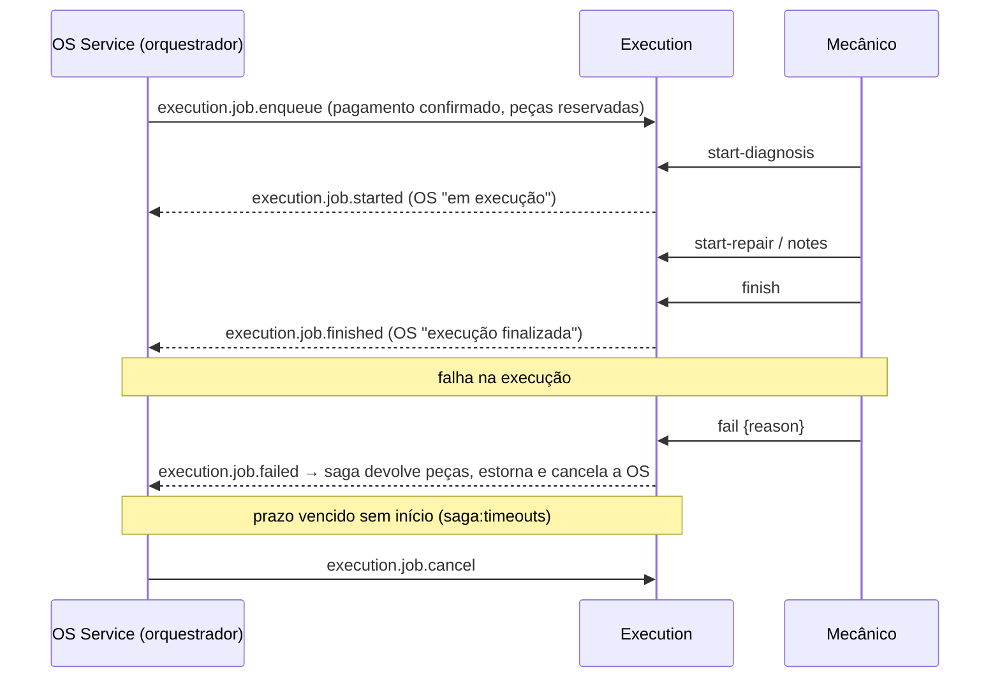

# oficina-execution-service

**Execution Service** do Tech Challenge **Fase 4 — Oficina Mecânica**. Cuida da **fila de execução** das ordens de serviço: o mecânico assume a OS, faz o diagnóstico e o reparo, e o fim da execução é comunicado ao OS Service. É o terceiro participante da **Saga orquestrada** pelo OS Service.

| Repo | Papel |
|---|---|
| [oficina-api](https://github.com/MicaelHernandes/oficina-api) | OS Service: clientes, veículos, catálogo, estoque e OS; **orquestrador da saga** (PostgreSQL) |
| [oficina-billing-service](https://github.com/MicaelHernandes/oficina-billing-service) | Orçamento e pagamento via Mercado Pago (DynamoDB) |
| **oficina-execution-service** (este) | Fila de execução, diagnóstico e reparo (**PostgreSQL**, database próprio) |
| [oficina-k8s-infra](https://github.com/MicaelHernandes/oficina-k8s-infra) | VPC, EKS, ECR, ALB, DNS/TLS, monitoring, OIDC |
| [oficina-db-infra](https://github.com/MicaelHernandes/oficina-db-infra) | RDS PostgreSQL (e a credencial `/oficina/rds/execution`) |
| [oficina-auth-lambda](https://github.com/MicaelHernandes/oficina-auth-lambda) | Lambda de auth por CPF + API Gateway |

## Tecnologias

- **PHP 8.4 / Laravel 13**, DDD em `src/Execution` (Domain, Application, Infrastructure, Presentation).
- **PostgreSQL**: database `execution` e usuário `execution_svc` próprios, na instância RDS compartilhada. Nenhum outro serviço conecta nele.
- **SNS + SQS** (mensageria da saga), **Pest**, **Pint**, **PHPStan/Larastan** (nível 5), **l5-swagger**, **prometheus_client_php** (APCu).
- **Docker** (php-fpm) + **nginx sidecar**, **Kustomize**, **Terraform** (`infra/`), deploy no **EKS**.

## Papel na saga



```
queued ──start-diagnosis──▶ diagnosing ──start-repair──▶ repairing ──finish──▶ finished
   │                            │                            │
   └────────── fail ────────────┴──────────── fail ──────────┴──▶ failed
   └──── execution.job.cancel (saga) ──▶ cancelled
```

- **Idempotência:** cada comando é processado com **inbox** na mesma transação. Além disso, uma OS tem no máximo uma execução ativa, então um pedido repetido não duplica a fila.
- **Outbox:** início, fim e falha gravam o evento em `outbox_messages` na mesma transação da mudança de estado. O `execution:relay` publica no SNS depois do commit.
- **Linha do tempo:** cada etapa e cada anotação do mecânico ficam em `execution_job_events`.

## Rotas (prefixo `/execution/api`, roteado pelo ALB em `app.codefive.com.br`)

Todas exigem `Authorization: Bearer <EXECUTION_API_TOKEN>` (Secrets Manager `/oficina/execution/api-token`).

| Rota | Uso |
|---|---|
| `GET jobs[?status=]` | Fila: maior prioridade e mais antigas primeiro (sem filtro, só as ativas) |
| `GET jobs/{id}` | Execução com a linha do tempo |
| `POST jobs/{id}/start-diagnosis` | `queued → diagnosing` (publica `execution.job.started`) |
| `POST jobs/{id}/start-repair` | `diagnosing → repairing` |
| `POST jobs/{id}/notes` | Anotação na linha do tempo |
| `POST jobs/{id}/finish` | `repairing → finished` (publica `execution.job.finished`) |
| `POST jobs/{id}/fail` | `→ failed` (publica `execution.job.failed`, que dispara a compensação) |
| `GET execution/api/documentation` | Swagger |
| `GET /metrics` | Prometheus (só dentro do cluster) |

## Banco próprio no RDS compartilhado

Para não pagar uma segunda instância, o serviço usa **database e usuário próprios** na mesma instância RDS:

- O `oficina-db-infra` gera a credencial `/oficina/rds/execution`.
- O deploy roda o Job `k8s/jobs/db-bootstrap-job.yaml`, que é idempotente: ele cria ou atualiza o role `execution_svc`, cria o database `execution` com esse dono e revoga o `CONNECT` público dos databases `execution` e `oficina`.
- As credenciais master só existem num Secret temporário, apagado ao fim do Job.
- A aplicação conecta só com `execution_svc`, com TLS (`DB_SSLMODE=require`).

## Observabilidade

- **Logs JSON** no stdout com `saga_id`, `correlation_id` e `os_id`. O `correlation_id` é o mesmo da abertura da OS no OS Service, para rastrear a OS no Loki.
- **`/metrics`:** latência por rota, `oficina_execution_jobs{status}`, `oficina_execution_avg_execution_seconds` e `oficina_execution_outbox_pending_messages`.

## Desenvolvimento local

```bash
composer install
cp .env.example .env && php artisan key:generate
# Postgres local com o database "execution" (ou ajuste DB_* no .env)
php artisan migrate
php artisan test --coverage
./vendor/bin/pint --test
./vendor/bin/phpstan analyse --memory-limit=1G
```

## Testes e cobertura

**23 testes, cobertura de 95%** (mínimo de 80% exigido no CI). Os testes cobrem:

- os comandos da saga, incluindo idempotência e a regra de uma execução ativa por OS;
- o fluxo do mecânico pela API, com eventos e linha do tempo;
- transições inválidas;
- os workers (consume e relay), as métricas, a entidade, o envelope e os adaptadores SNS/SQS.

O relatório `coverage.xml` de cada execução fica como artefato do workflow **CI**.

## CI/CD

- **`ci.yml`** (PR e push em `homolog`/`master`): Pint + PHPStan + Pest com PostgreSQL (cobertura ≥ 80%) + `terraform fmt/validate` + `docker build`.
- **`deploy.yml`** (push em `master`, `environment: production`):
  1. `terraform apply` da `infra/`;
  2. build e push no ECR;
  3. Secret (Secrets Manager);
  4. **Job de bootstrap do banco**;
  5. ConfigMap de runtime (SSM);
  6. IRSA no ServiceAccount;
  7. `kubectl apply -k k8s/overlays/prod`;
  8. **Job de migrations**;
  9. `rollout status`.
- **Secrets do repositório:** `AWS_ROLE_ARN` (role OIDC `oficina-gha-oficina-execution-service`) e `LARAVEL_APP_KEY`. Environment `production`.
- Actions fixadas por SHA do commit.

## Dependência de ordem

1. **oficina-k8s-infra** (ECR, OIDC, `/oficina/eks/oidc_provider_arn`).
2. **oficina-db-infra** (credencial `/oficina/rds/execution`).
3. **oficina-api** com a `infra/` aplicada (tópico `oficina-os-events`).
4. **Este repositório.**
5. De volta ao **oficina-api**: incluir `oficina-execution-events` em `consumed_topics` para o OS Service receber os eventos.

## Custo

SNS e SQS cobram por uso, e o banco usa a instância RDS existente. Os pods rodam no EKS existente. **Destruir o ambiente após a apresentação.**
